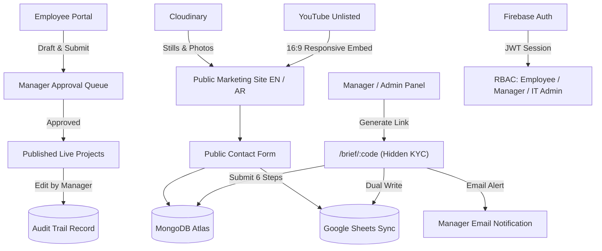
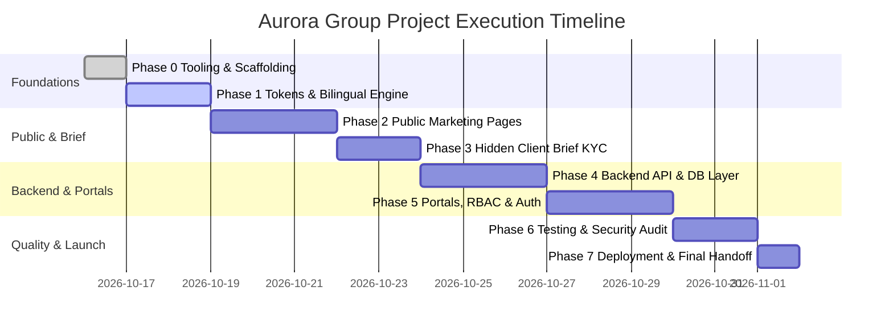

# Aurora Group Website & Portal — Master Implementation Roadmap (A to Z)

**Document Reference:** [aurora_srs_v1.md](file:///d:/Aurora/Website/aurora_srs_v1.md)  
**Version:** 1.0  
**Prepared for:** Ziad Bahgat & Aurora Group  
**Target Architecture:** Multi-page bilingual (EN/AR RTL) web platform, Node.js/Express API, MongoDB Atlas, Firebase Authentication, Cloudinary, and YouTube unlisted embeds.

---

## 1. Executive Summary & Scope

The Aurora Group web ecosystem consists of three interconnected layers:
1. **Public Marketing Website:** Bilingual (English LTR and Arabic RTL), responsive, lightweight, high-performance showcase of capabilities, verified credentials (30+ projects, 5M+ reach), client portfolio, and contact funnel.
2. **Hidden Client Brief Intake Engine (`/brief/<code>`):** Standalone, unlisted, search-engine-excluded 6-step onboarding wizard for clients prior to meetings at Sharks Office Space. Includes token expiration and automatic dual-write to MongoDB and Google Sheets.
3. **Role-Based Internal Operations Hub:**
   - **Employee Portal (`/portal`):** Profile management, project authoring, media attachment, and manager approval submissions.
   - **Manager & IT Admin Panel (`/admin`):** Project approval workflow, audit trail logging, client brief generator (with instant WhatsApp message copying), draft project lifecycle management, and global site settings.



---

## 2. Design System & Token Strategy

Based on the verified tokens established in [aurora_srs_v1.md](file:///d:/Aurora/Website/aurora_srs_v1.md) and [blueprint.html](file:///d:/Aurora/Website/blueprint.html):

### 2.1 Color Rules & Strict Constraints
- **Primary Surfaces:** Light-led palette (`--surface-page: #F5F6FC`, cards `--surface-raised: #FFFFFF`, alternate `--surface-sunken: #EBEDF7`).
- **Dark Bands (Strict Rule):** Exactly four places are dark bands: **Hero, Numbers Band, Final CTA, and Global Footer** (`--surface-band: #0A0F33` in light; near-black `#060923` in dark mode).
- **Accents:** Vibrant Purple (`#6A00F4`) on light surfaces; Electric Teal (`#00FFC0`) **exclusively** on dark backgrounds (never on white).
- **Aesthetic Direction:** Flat cards, thin borders (`1px solid rgba(10, 15, 51, 0.10)`), subtle elevation shadows, rounded buttons (not pill-shaped), zero glassmorphism, zero blur effects, zero floating 3D graphics.
- **Copywriting Tone:** Plain, direct, professional corporate copywriter tone. **Zero emojis in UI and content**, no AI buzzwords ("leading", "world-class").

### 2.2 Typography & Dual-Theme Behavior
- **Typography:** Latin font `Inter` (`wght@400;500;600;700;800;900`); Arabic font `IBM Plex Sans Arabic` and `Cairo` with increased font size and looser line height for Arabic legibility.
- **Theme Modes:**
  - Public & Brief: Light default (Light / Dark toggle; remembers choice in `localStorage`; no FOUC).
  - Portals & Admin: System default (Light / Dark / System segmented selector; stored in user profile).
  - Global Footer stays dark across both modes for brand continuity.
  - White wordmark logo swap for dark mode.

---

## 3. Technology Architecture & Services

| Concern | Technology / Service | Tier | Description & Responsibility |
|---|---|---|---|
| **Frontend Platform** | Semantic HTML5, Modular CSS Tokens, Vanilla JS / ES Modules | Built-in | Ultra-fast load times, zero bundle overhead, pristine SEO, perfect RTL support. |
| **Backend API** | Node.js (Express.js REST API) | Local / Cloud | Handles routing, API endpoints, brief token validation, Google Sheets sync, email triggers, and RBAC guards. |
| **Authentication** | Firebase Authentication | Free Tier | Email/password login, password resets, verification emails. Zero credential storage in custom DB. |
| **Structured Database** | MongoDB Atlas (M0) / Local Mongoose | Free Tier (512MB) | Stores projects, client inquiries, briefs, user roles, audit trails, and site configuration. |
| **Asset Storage** | Cloudinary | Free Tier (25GB) | High-res photography, design stills, automatic optimization, WebP delivery. |
| **Video Delivery** | YouTube (Unlisted Embeds) | Free Unlimited | 16:9 responsive embeds with `rel=0&modestbranding=1`, standard controls, no autoplay. |
| **Spreadsheet Sync** | Google Sheets API v4 | Free Tier | Dual-write client inquiries and brief responses to "Aurora Client Briefs" Google Sheet. |
| **Notifications** | Transactional SMTP / Nodemailer | Free Tier | Manager alerts on project submissions and brief completions. |
| **Analytics** | Google Analytics 4 (GA4) | Free | Internal telemetry for pageviews and video engagement, accessible only to Managers/Admins. |

---

## 4. Master Phase-by-Phase Implementation Plan

### Phase 0: Development Environment & Project Scaffolding
- [ ] **Step 0.1:** Install Node.js LTS runtime on the development machine via `winget` and configure PowerShell PATH.
- [ ] **Step 0.2:** Initialize project repository structure:
  ```text
  d:/Aurora/Website/
  ├── client/                     # Frontend public & portal application
  │   ├── css/                    # Tokens, layout, components, rtl, themes
  │   ├── js/                     # Router, i18n, theme engine, modals, forms
  │   ├── assets/                 # SVGs, wordmarks, icons, placeholder stills
  │   ├── pages/                  # Static HTML templates (EN & AR)
  │   └── index.html              # Core application entry
  ├── server/                     # Backend API & Integrations
  │   ├── config/                 # DB, Firebase, Cloudinary, Sheets setup
  │   ├── controllers/            # Projects, Briefs, Inquiries, Auth, Admin
  │   ├── models/                 # Mongoose schemas (Project, Brief, Inquiry, Log)
  │   ├── routes/                 # Express REST endpoints
  │   ├── services/               # Google Sheets API, Emailer, Translation service
  │   ├── middleware/             # Firebase JWT verification, RBAC guard, Rate-limiter
  │   └── server.js               # Express application entry
  ├── .env.example                # Template for environment secrets
  └── package.json                # Dependencies and dev scripts
  ```
- [ ] **Step 0.3:** Establish `.env` configuration file with development defaults and mock service fallbacks so development runs smoothly even before external credentials (e.g. live Google Sheets) are plugged in.

---

### Phase 1: Design Tokens, Layout System & Bilingual Engine
- [ ] **Step 1.1:** Extract and modularize semantic CSS tokens from `blueprint.html` into `client/css/tokens.css` with light and dark variables.
- [ ] **Step 1.2:** Build the theme switcher engine with instant inline head-script execution to prevent any Flash of Unstyled Content (FOUC).
- [ ] **Step 1.3:** Implement the bidirectional engine (`client/js/i18n.js`):
  - LTR for English (`lang="en" dir="ltr"`), RTL for Arabic (`lang="ar" dir="rtl"`).
  - Mirroring rules: flip navigation drawers, chevrons, form layouts; **do not flip** logos, media play buttons, photography, and phone numbers.
  - Strict adherence to Western digits (`0-9`) in both English and Arabic content.
- [ ] **Step 1.4:** Construct the global responsive header (with desktop nav, language toggle, theme toggle, mobile drawer) and the persistent dark footer with Egyptian business coordinates (Sharks Office Space, Abdelsalam El Shazly St, above Next Bank).

---

### Phase 2: Public Marketing Pages (EN & AR Route Parity)
- [ ] **Step 2.1: Home Page (`/` and `/ar/`)**
  - Dark Hero band (no autoplay video; high-contrast action purple/teal).
  - Client Brands logo strip (verified client roster: Omar Bakoush, Mohamed Raslan, Taj Aleatur, Dr. Mohamed Anwar Oref, Dar El Tabeeb, X Fighter Academy).
  - Integrated Capabilities (Services overview cards).
  - Selected Work preview grid with direct links to case studies.
  - Dark Numbers Band: **30+ Projects Completed**, **5M+ Audience Reach**, Videos Produced, Brand Designs.
  - 6-step agency execution process & "What Happens Next" onboarding timeline.
  - Testimonials section (configured with conditional visibility toggle, hidden by default per SRS Section 3.5).
  - Final Dark CTA band.
- [ ] **Step 2.2: About Page (`/about` and `/ar/about`)**
  - Agency story, values, positioning, and on-the-ground Egyptian operational focus.
- [ ] **Step 2.3: Services Hub (`/services` and `/ar/services`)**
  - Filtering by Marketing & Growth vs. Media Production.
  - Detailed service breakdowns: Social Media, Paid Ads Scaling, Brand Identity, Cinema & Reel Production, Web Design.
- [ ] **Step 2.4: Projects Portfolio (`/projects` and `/ar/projects`)**
  - Filterable gallery by **industry category** (Perfumes, Medical, Fitness, Corporate).
- [ ] **Step 2.5: Case Study Page Template (`/projects/:slug` and `/ar/projects/:slug`)**
  - Standardized rigid structure (Client name, industry category, year, credited team, deliverables, challenge, solution, results).
  - Cloudinary photo gallery with lightbox viewer.
  - YouTube 16:9 unlisted responsive embed with `rel=0&modestbranding=1`.
  - **Zero budget fields displayed publicly**.
- [ ] **Step 2.6: Contact Page (`/contact` and `/ar/contact`)**
  - Public contact form with client requirements (name, brand, phone/WhatsApp, email, services, industry free text, EGP budget band dropdown, message).
  - Rate limiting & anti-spam honeypot.
  - Egyptian contact details, working hours, and Sharks Office Space map embed link.
- [ ] **Step 2.7: Team & Team Profile Pages (`/team`, `/team/:id`)**
  - Built with modular placeholder data; hidden from navigation per SRS Section 3.6 until real photography & staff roster are provided by Ziad.

---

### Phase 3: Hidden Client Brief Engine (`/brief/<code>`)
- [ ] **Step 3.1:** Standalone page route isolated from main navigation, header, footer, and excluded from sitemap and search engine crawlers (`noindex, nofollow`).
- [ ] **Step 3.2:** Token verification middleware:
  - Validates unique code, checks expiration timestamp (default 10 or 30 days, extendable up to 30 days from edit date).
  - Enforces single-submission lock (prevents re-submitting after completion).
  - Pre-fills personalized client/brand greeting (e.g. "Welcome Mohamed Raslan").
- [ ] **Step 3.3:** Interactive 6-step wizard with persistent progress indicator:
  - Step 1: Contact & Brand Basics
  - Step 2: Business Model & Market Offering
  - Step 3: Strategic Goals & Revenue Targets
  - Step 4: Current Digital Assets & Social Channels
  - Step 5: Competitors, Aesthetics & Visual Taste Profile
  - Step 6: Strategy Meeting Preparation at Sharks Office Space
- [ ] **Step 3.4:** Submission pipeline:
  - Saves full payload to MongoDB Atlas.
  - Synchronizes row to Google Sheets ("Aurora Client Briefs" -> "Briefs" tab).
  - Sends immediate email notification to Manager login address.
  - Displays polished completion card with meeting instructions.

---

### Phase 4: Backend API & Data Persistence Layer
- [ ] **Step 4.1:** MongoDB Schema modeling with Mongoose:
  - `Project`: title, slug, clientName, industry, year, challenge, solution, result, deliverables, mediaGallery, creditedStaff, status (`draft`, `pending_approval`, `approved`, `in_progress`, `dead`, `ended`), auditLog.
  - `Inquiry`: name, brand, phone, email, services, industry, budget, message, source, createdAt.
  - `Brief`: token, clientName, brandName, expiryDate, isSubmitted, submissionData, createdAt.
  - `AuditLog`: action, targetId, modifiedBy, timestamp, changesSummary.
  - `SiteSettings`: officeAddress, phone, contactEmail, socialLinks, meetingVenue.
- [ ] **Step 4.2:** Google Sheets integration service (`server/services/sheetsService.js`) using Google Service Account credentials with automated failover and local queuing in case of API rate limits.
- [ ] **Step 4.3:** Cloudinary media upload endpoint (`/api/media/upload`) generating signed upload parameters for secure frontend direct upload.
- [ ] **Step 4.4:** Email dispatch service (`server/services/mailer.js`) triggered on:
  - Employee project submission for approval.
  - Client brief form completion.
- [ ] **Step 4.5:** Auto-translation helper (`server/services/translationService.js`) to auto-generate Arabic strings from English inputs for bios and project descriptions, flagged with `pending_review: true`.

---

### Phase 5: Authentication, RBAC & Portal Dashboards
- [ ] **Step 5.1:** Firebase Authentication frontend integration (clean email/password login modal/page, password recovery workflow).
- [ ] **Step 5.2:** Role-Based Access Control middleware:
  - **Employee:** Can edit own profile, author projects, upload/reuse media, submit for review.
  - **Manager:** Can approve/reject projects (approved goes live immediately), edit any live project with automatic audit logging, view all briefs, generate brief tokens with WhatsApp invitation copy, create draft projects, change project status (`in progress`, `dead`, `ended`), access GA4 dashboard, edit global settings.
  - **IT Super Admin:** All Manager capabilities plus system-level diagnostics.
- [ ] **Step 5.3: Employee Portal UI (`/portal`)**
  - Profile editor with bio character counter (180 chars) and photo uploader.
  - Project authoring drawer with YouTube link validation and media asset picker.
  - Status list showing personal submitted works (Draft, Under Review, Live).
- [ ] **Step 5.4: Manager Control Panel UI (`/admin`)**
  - **Approval Queue:** Review pending employee uploads with 1-click Approve or Reject.
  - **Live Projects Manager:** Edit any live project; every change appended to `auditLog`.
  - **Briefs & CRM Hub:** Table of submitted briefs, printable Meeting Prep Sheet modal, and "Create Draft Project" action.
  - **Brief Link Generator Modal:** Input client name, select expiry, preview and 1-click copy customized Arabic WhatsApp invitation message.
  - **Site Settings:** Update office coordinates, meeting venue text, and contact emails.

---

### Phase 6: Quality Assurance, Security & Browser Validation
- [ ] **Step 6.1:** Comprehensive browser testing using Antigravity browser subagent:
  - Dual-theme switching verification (Light & Dark) across all screens.
  - Bilingual mirroring validation (RTL layout, typography, navigation alignment).
  - Public contact form validation and submission test.
  - Client brief 6-step progression and submission test.
  - Employee login -> Project upload flow test.
  - Manager login -> Approval flow and link generation test.
- [ ] **Step 6.2:** Mobile responsiveness audit (375px, 768px, 1024px, 1440px) ensuring inline video playback and zero horizontal scroll.
- [ ] **Step 6.3:** SEO and accessibility verification:
  - Structured JSON-LD schema for LocalBusiness and Organization.
  - Correct OpenGraph and Twitter cards.
  - `robots.txt` and `sitemap.xml` properly configured to index public pages and disallow `/portal`, `/admin`, and `/brief/*`.
- [ ] **Step 6.4:** Anti-spam and security testing (rate limiting on contact and brief endpoints, sanitize all input fields).

---

### Phase 7: Deployment Readiness & Launch Checklist
- [ ] **Step 7.1:** Local build sign-off and environment variable checklist.
- [ ] **Step 7.2:** GitHub Student Developer Pack domain configuration and SSL setup walkthrough.
- [ ] **Step 7.3:** Review of the 11 Open Items from SRS Section 11 with Ziad (e.g., City name, white wordmark logo, brief link default expiry, budget bands).

---

## 5. Timeline & Milestones Summary



---

## 6. Open Items from SRS Section 11 to Confirm with Ziad

| # | Item | Status / Proposal | Action Required |
|---|---|---|---|
| 1 | City name and Google Maps link for Sharks Office Space | Abdelsalam El Shazly St, above Next Bank | Need city name (e.g. Damanhour / Alexandria) & exact Google Maps pin URL |
| 2 | White-wordmark logo version for Dark Mode | Black SVG exists in blueprint; white SVG inversion needed | Invert SVG fill or provide dedicated white asset |
| 3 | Working hours for Contact page & footer | Proposed: Sun–Thu, 10:00 AM – 6:00 PM | Confirm exact agency working hours |
| 4 | Real team member names, titles, photos | Team page hidden until provided | Will populate dummy data and leave hidden in nav |
| 5 | Real client testimonial quotes (3+ needed) | Section built but hidden per SRS 3.5 | Keep hidden until quotes provided |
| 6 | Client count figure (separate from 30+ projects) | Stored as configurable setting | Confirm client count number |
| 7 | Reply time promise on Contact page | Proposed: "Within 1 business day" | Confirm promise wording |
| 8 | Client brief link default expiry | 10 days vs 30 days | Defaulting to 30 days (extendable up to 30 days from edit) |
| 9 | EGP budget dropdown bands | Starting at "Less than 3,000 EGP" | Proposed bands: <3k, 3k-10k, 10k-25k, 25k-50k, 50k-100k, 100k+ |
| 10 | IT Super Admin capabilities | Future phase | Role schema prepared; inherits Manager rights |
| 11 | Final domain name | GitHub Student Pack | Configure post-local build |

---

*This roadmap serves as the master blueprint for building the Aurora Group web platform from A to Z.*
